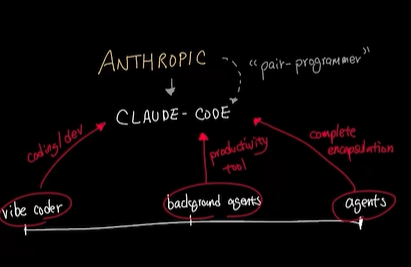
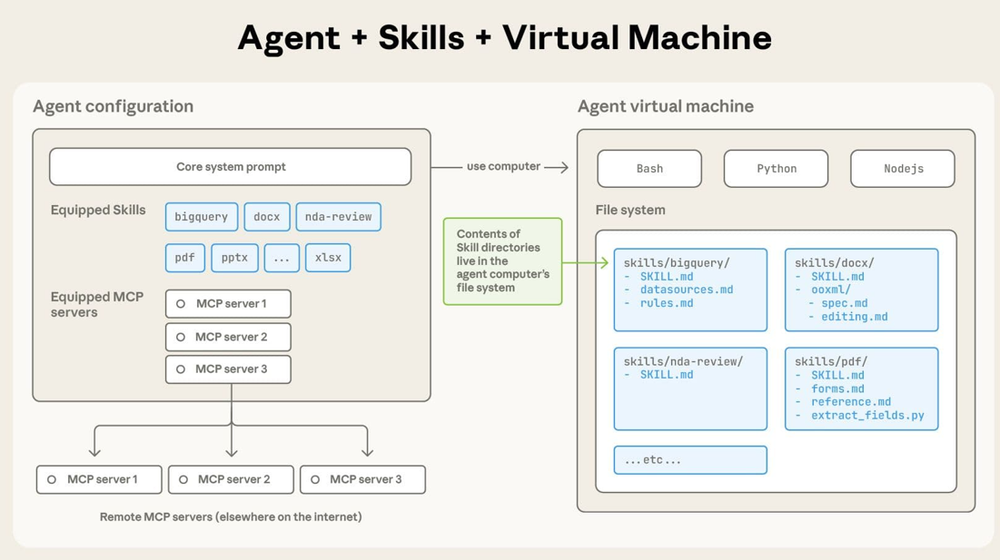
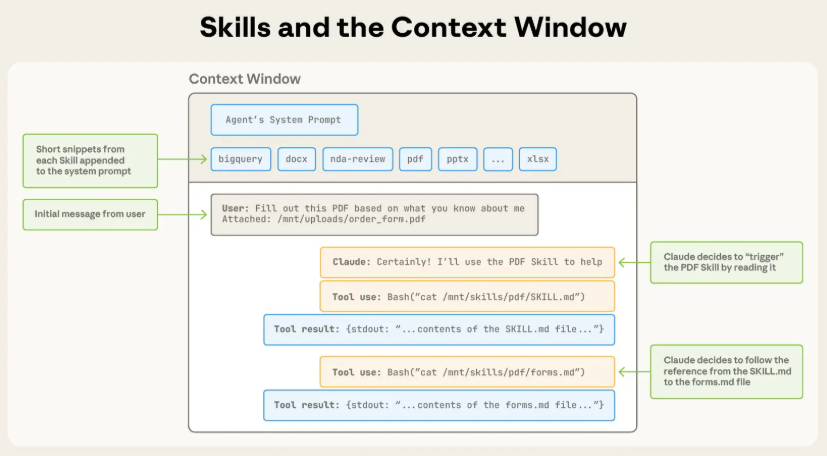

Claude code can access your project (including files in the project directory and subdirectories), your terminal (including build tools, git, scripts etc.), git state, CLAUDE.md file (project level memory), Auto memory and extensions (via MCP servers).

**The core building blocks**:

**CLAUDE.md**: loaded into context every session; use it to describe project conventions, tech stack, structure, commands, and key patterns. 
Substack

**Skills**: reusable workflow instructions Claude picks up when relevant (or you invoke as slash commands). Skills can run as a subagent by adding context: fork to their front matter, so they don’t bloat your main session. 
Substack

**Hooks**: shell commands that run automatically at specific points in Claude’s workflow. Unlike skills, which Claude decides when to use, hooks are deterministic and fire every time their trigger is met (e.g., auto-format after every edit, block writes to .env). 
Substack

**Subagents**: processes the main agent can delegate scoped tasks to, running in the background or foreground and freeing up the main agent’s context. 

**MCP servers**: connect Claude to external services (databases, GitHub, Slack, etc.).

**Plugins**: distributable packages that bundle skills, subagents, hooks, MCP servers, and LSP servers, so whole workflows can be shared across teams. 

**Agent SDK**: the same agent harness exposed as a library, so you can build your own agents on top of it.

Available on the terminal (VS Code, Jetbrains IDE, etc.) and web through https://claude.ai/code.

[Claude cookbook](https://platform.claude.com/cookbook)

[Claude code complete guide](https://timewell.jp/en/columns/claude-code-complete-guide)

[Claude code Discord](https://discord.com/app/invite-with-guild-onboarding/6PPFFzqPDZ)

## Tools

It comes with builtin tools, skills and MCP servers including:
- **[36 Tools](https://code.claude.com/docs/en/tools-reference)**: Bash, PowerShell, Glob, Grep, LSP, WebFetch, CronCreate, etc.
- **[13 Skills](https://www.anthropic.com/research/equipping-agents-for-the-real-world-with-agent-skills)**: 
    - [Anthropic docs](https://github.com/anthropics/skills)
    - E.g. the [PDF skill](https://github.com/anthropics/skills/blob/main/skills/pdf/SKILL.md)
    - Browser use, computer use, deep research, docsx, pdf, xlsx, pptx, Google workspace, memory importer,  and morning.
- **MCP**: Claude Docs, Google Drive, Github etc.

### Built-in tools

| Category | What Claude can do |
|---|---|
| File operations | Read files, edit code, create new files, rename and reorganize |
| Search | Find files by pattern, search content with regex, explore codebases |
| Execution | Run shell commands, start servers, run tests, use git |
| Web | Search the web, fetch documentation, look up error messages |
| Code intelligence | See type errors and warnings after edits, jump to definitions, find references (requires code intelligence plugins

### Skills

Skills and the context window:

## Commands

The context window is Claude's working memory. 

/context
  ⎿  Context Usage
     ⛀ ⛁ ⛁ ⛁ ⛁ ⛀ ⛁ ⛁ ⛁ ⛁ ⛁ ⛁ ⛁ ⛁ ⛁ ⛁ ⛁ ⛀ ⛶ ⛶   Sonnet 5.5
     ⛶ ⛶ ⛶ ⛶ ⛶ ⛶ ⛶ ⛶ ⛶ ⛶ ⛶ ⛶ ⛶ ⛶ ⛶ ⛶ ⛶ ⛶ ⛶ ⛶   claude-sonnet-5-5
     ⛶ ⛶ ⛶ ⛶ ⛶ ⛶ ⛶ ⛶ ⛶ ⛶ ⛶ ⛶ ⛶ ⛶ ⛶ ⛶ ⛶ ⛶ ⛶ ⛶   81.2k/1m tokens (8%)
     ⛶ ⛶ ⛶ ⛶ ⛶ ⛶ ⛶ ⛶ ⛶ ⛶ ⛶ ⛶ ⛶ ⛶ ⛶ ⛶ ⛶ ⛶ ⛶ ⛶
     ⛶ ⛶ ⛶ ⛶ ⛶ ⛶ ⛶ ⛶ ⛶ ⛶ ⛶ ⛶ ⛶ ⛶ ⛶ ⛶ ⛶ ⛶ ⛶ ⛶   Estimated usage by category
     ⛶ ⛶ ⛶ ⛶ ⛶ ⛶ ⛶ ⛶ ⛶ ⛶ ⛶ ⛶ ⛶ ⛶ ⛶ ⛶ ⛶ ⛶ ⛶ ⛶   ⛁ System prompt: 2.9k tokens (0.3%)
     ⛶ ⛶ ⛶ ⛶ ⛶ ⛶ ⛶ ⛶ ⛶ ⛶ ⛶ ⛶ ⛶ ⛶ ⛶ ⛶ ⛶ ⛶ ⛶ ⛶   ⛁ System tools: 18.6k tokens (1.9%)
     ⛶ ⛶ ⛶ ⛶ ⛶ ⛶ ⛶ ⛶ ⛶ ⛶ ⛶ ⛶ ⛶ ⛶ ⛶ ⛶ ⛶ ⛶ ⛶ ⛶   ⛁ MCP server instructions: 717 tokens (0.1%)
     ⛶ ⛶ ⛶ ⛶ ⛶ ⛶ ⛶ ⛶ ⛶ ⛶ ⛶ ⛶ ⛶ ⛶ ⛶ ⛶ ⛶ ⛶ ⛶ ⛶   ⛁ Skills: 5.7k tokens (0.6%)
     ⛶ ⛶ ⛶ ⛶ ⛶ ⛶ ⛶ ⛶ ⛶ ⛶ ⛶ ⛶ ⛶ ⛝ ⛝ ⛝ ⛝ ⛝ ⛝ ⛝   ⛁ Messages: 53.2k tokens (5.3%)
                                               ⛶ Free space: 885.8k (88.6%)
                                               ⛝ Autocompact buffer: 33k tokens (3.3%)

     Auto-compact window: 1m tokens

     MCP tools · /mcp (loaded on-demand)
     └ 10 tools · 0 tokens

     Skills · /skills
     └ 29 skills · 5.7k tokens

     MCP tools · /mcp (loaded on-demand)

     Available
     ├ mcp__claude_ai_Claude_Docs__batch
     ├ mcp__claude_ai_Claude_Docs__create
     ├ mcp__claude_ai_Claude_Docs__delete
     ├ mcp__claude_ai_Claude_Docs__export
     ├ mcp__claude_ai_Claude_Docs__guide
     ├ mcp__claude_ai_Claude_Docs__query
     ├ mcp__claude_ai_Claude_Docs__read
     ├ mcp__claude_ai_Claude_Docs__update
     ├ mcp__claude_ai_Google_Drive__authenticate
     └ mcp__claude_ai_Google_Drive__complete_authentication

     Skills · /skills

     claude.ai sync
     ├ docs: ~340 tokens
     ├ pptx: ~330 tokens
     ├ google-workspace: ~330 tokens
     ├ xlsx: ~320 tokens
     ├ computer-use: ~320 tokens
     ├ docx: ~320 tokens
     ├ built-in-browser: ~290 tokens
     ├ chrome-browser: ~260 tokens
     ├ deep-research: ~200 tokens
     ├ pdf: ~150 tokens
     ├ morning: ~120 tokens
     ├ skill-creator: ~120 tokens
     └ import-memory: ~60 tokens

     Built-in
     ├ dataviz: ~480 tokens
     ├ code-review: ~400 tokens
     ├ claude-api: ~360 tokens
     ├ artifact-capabilities: ~250 tokens
     ├ update-config: ~240 tokens
     ├ schedule: ~130 tokens
     ├ run: ~120 tokens
     ├ loop: ~120 tokens
     ├ plugin-authoring: ~90 tokens
     ├ keybindings-help: ~80 tokens
     ├ artifact-diagramming: ~70 tokens
     ├ artifact-design: ~70 tokens
     ├ fewer-permission-prompts: ~60 tokens
     ├ simplify: ~60 tokens
     ├ security-review: ~30 tokens
     └ init: ~20 tokens